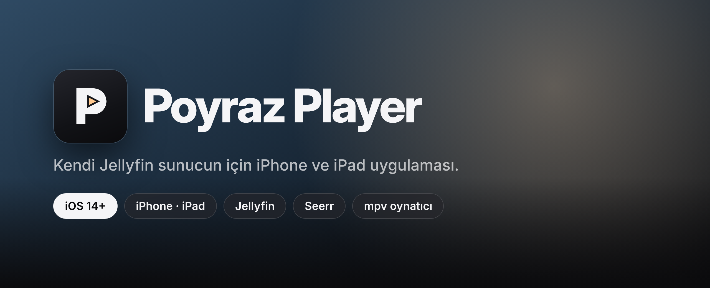
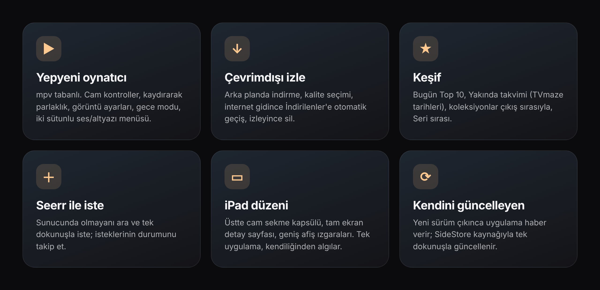

<p align="center">
  
</p>

<p align="center">
  <a href="https://github.com/poyrazsenn/jellyplus-ios/releases"></a>
  
  
  
  <a href="LICENSE"></a>
</p>

**Poyraz Player**, kendi [Jellyfin](https://jellyfin.org) sunucundaki film ve dizileri iPhone ve iPad'de izlemek için yazılmış bir uygulama. Sade, iOS'a özgü bir arayüzü, mpv tabanlı güçlü bir oynatıcısı ve çevrimdışı izleme desteği var. [Seerr](https://github.com/seerr-team/seerr) bağlıysa sunucunda olmayanı uygulamanın içinden isteyebilirsin.

> Jellyfin'in resmi uygulaması değildir; Jellyfin ekibiyle bağlantısı yoktur.

<p align="center">
  
</p>

## Özellikler

### 🎬 Oynatıcı
- **mpv tabanlı** ([media_kit](https://github.com/media-kit/media-kit)): neredeyse her biçimi doğrudan oynatır, sunucuda dönüştürme gerektirmez
- **Cam kontroller**: üstte Görüntü · Ses ve altyazı · Bölümler kapsülü, ortada büyük oynat, 10 sn ileri/geri
- **Ses ve altyazı menüsü**: iki sütun; ses dili, hız, **gece modu** · altyazı, zamanlama (± 0,25 sn), altyazı arama ve indirme
- **Görüntü paneli**: ekran parlaklığı, parlaklık/kontrast/doygunluk/gama ayarı; karanlık sahneler için
- Sol tarafta yukarı/aşağı kaydırarak **parlaklık**
- **Bölümler şeridi**: dizilerde oynatıcıdan çıkmadan sezon ve bölüm seç
- **Giriş/jenerik atlama**, sonraki bölüme geri sayımla geçiş, kaldığın yerden devam
- Altyazı görünümü: boyut, renk, arka plan, konum

### 🏠 Ana sayfa ve keşif
- Büyük **vitrin**, İzlemeye devam et, Listem, kütüphanelere göre yeni eklenenler
- **Bugün Top 10**: dünyada bugün popüler olanlardan arşivinde olanlar (Seerr ile)
- **Yakında**: takip ettiğin dizilerin yeni bölümleri; dizi sayfasında "Yeni bölüm · Cuma, 27 Kasım" kartı. Tarihler [TVmaze](https://www.tvmaze.com)'den, yayın platformuna göre doğru gün
- **Koleksiyonlar**: Harry Potter gibi seriler çıkış sırasıyla, "Sırayla izle" düğmesi ve film sayfasında Koleksiyon sekmesi
- Oyuncu sayfaları: biyografi, doğum/ölüm tarihi, filmografi

### ⬇️ İndirme ve çevrimdışı
- **Arka planda indirme**: telefon kilitliyken ve uygulama kapalıyken de sürer, kaldığı yerden devam eder
- Kalite seçimi: orijinal ya da küçük (720p)
- Bölüm bölüm ya da **sezonun tamamını** indir
- İnternet kesilince **İndirilenler'e otomatik geçiş**; çevrimdışı izlediğin ilerleme sunucuya sonra yazılır
- İzleyince otomatik silme

### 🙋 Seerr ile istek
- Aramada sunucunda olmayan yapımlar da çıkar, **tek dokunuşla iste**
- Profil → İsteklerim: isteklerin ve indirme durumları

### 📱 iPhone'a özgü arayüz
- Havada duran cam sekme çubuğu, büyük iOS başlıkları, iOS anahtarları ve menüleri
- Dokunuşlarda hafif titreşim, iOS yenileme göstergesi, sayfa geçiş animasyonları
- Tasarım: "Cam" (koyu zemin, buğulu cam yüzeyler, beyaz kapsül düğmeler)

### 🖥️ iPad
- Üstte ortalanmış **cam sekme kapsülü**
- **Tam ekran detay sayfası**: boydan boya görsel, altında iki sütun bilgi
- Ekran genişliğine göre kendiliğinden geçer; tek uygulama, ayrı sürüm yok

### 🔄 Güncellemeler
- Yeni sürüm çıkınca uygulama **kendisi haber verir** (betalar dahil)
- **SideStore kaynağı** ile tek dokunuşla güncelleme
- Her güncellemeden sonra "Bu sürümde yeni" sayfası

## Kurulum

Poyraz Player App Store'da yok; IPA dosyası olarak yan yüklenir (sideload). Ücretsiz Apple ID yeterli, uygulama 7 günde bir yeniden imzalanır.

### Yol 1 · SideStore (önerilen, bilgisayarsız güncelleme)
1. [SideStore](https://sidestore.io)'u kur ([iloader](https://github.com/nab138/iloader) ile, bilgisayar sadece ilk seferde lazım).
2. SideStore → **Sources** → **+** → şu adresi ekle:
   ```
   https://raw.githubusercontent.com/poyrazsenn/jellyplus-ios/sidestore/sidestore.json
   ```
3. Poyraz Player'ı kur. Yeni sürümler **My Apps**'te "Update" olarak görünür; SideStore 7 günlük süreyi de kendisi yeniler.

### Yol 2 · Sideloadly
1. [Sürümler](https://github.com/poyrazsenn/jellyplus-ios/releases) sayfasından en yeni `JellyPlus.ipa`'yı indir.
2. [Sideloadly](https://sideloadly.io) ile iPhone ya da iPad'ine kur.
3. Ayrıntılı adımlar: [KURULUM.md](KURULUM.md)

### Gereksinimler
- iOS / iPadOS 14 veya üstü
- Bir Jellyfin sunucusu
- İsteğe bağlı: Seerr (istekler, Top 10, Keşfet)

## Sürümler ve yol haritası

| Sürüm | Durum |
|---|---|
| **2.1.1** | Kararlı sürüm |
| **3.0 beta** | Yeni tasarım (Cam), yeni oynatıcı, iPad düzeni, keşif. Betalar [Sürümler](https://github.com/poyrazsenn/jellyplus-ios/releases)'de |
| **3.0** | 18 Aralık 2026 |

Sıradakiler: Keşfet sekmesi (Seerr'den trendler, popüler ve yakında çıkacaklar), uzun basınca önizleme menüsü, ortak ayarlar.

## Ekran görüntüleri

Yakında. 3.0 kararlı sürümle birlikte buraya iPhone ve iPad ekran görüntüleri eklenecek.

## Kaynaktan derleme

Uygulama Flutter ile yazıldı. Her `main` ve `v2` gönderiminde GitHub Actions bir macOS makinesinde imzasız IPA üretir ve sürüm numarası yeniyse otomatik olarak yayınlar ([.github/workflows/ios.yml](.github/workflows/ios.yml)).

Kendin derlemek için (macOS + Xcode gerekir):
```bash
flutter create --platforms=ios --org com.jellyplus --project-name jellyplus .
flutter pub get
python3 tool/gen_whats_new.py
flutter build ios --release --no-codesign
```

- Sürüm numarası: `lib/version.dart` ve `pubspec.yaml`
- Sürüm notları: `RELEASE_NOTES.md` (uygulamadaki "Bu sürümde yeni" sayfası buradan üretilir)

## Teşekkürler

[Jellyfin](https://jellyfin.org) · [Seerr](https://github.com/seerr-team/seerr) · [media_kit / mpv](https://github.com/media-kit/media-kit) · [TVmaze](https://www.tvmaze.com) · [TMDB](https://www.themoviedb.org) · [SideStore](https://sidestore.io) · [background_downloader](https://pub.dev/packages/background_downloader)

## Lisans

[GNU AGPL-3.0](LICENSE)
